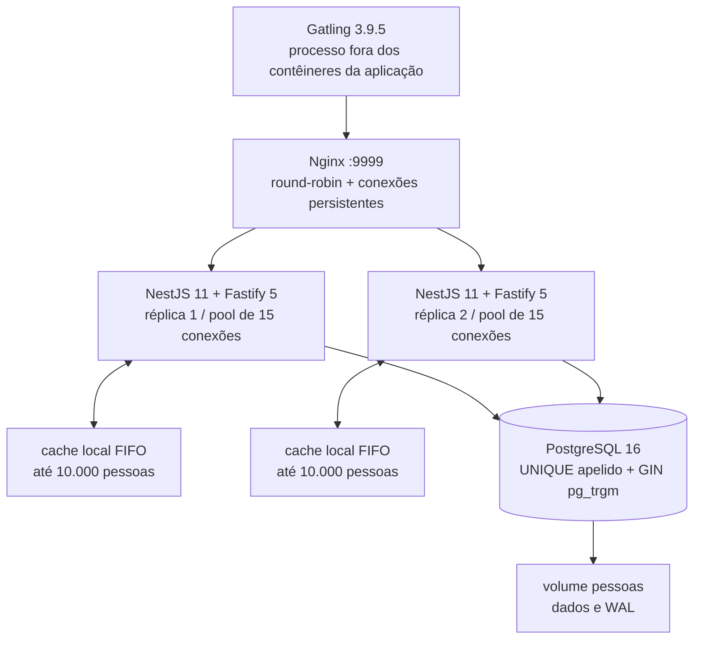

# Arquitetura e decisões

Esta implementação usa a especificação da Rinha de Backend 2023 Q3 como exercício de backend com NestJS e Docker. O contrato exige criação, leitura e busca de pessoas; não há atualização nem exclusão. Essa propriedade orienta o cache e simplifica a consistência.

## NestJS com Fastify e SQL direto

O NestJS fornece organização, injeção de dependências e gerenciamento de ciclo de vida. O adaptador Fastify recebe HTTP. O processo usa Node.js 24, compilação TypeScript e dependências de produção em uma imagem com múltiplos estágios; executa como usuário `node`, com heap V8 limitado a 256 MiB e orçamento total de 384 MiB por réplica. A diferença deixa espaço para buffers, código nativo e demais estruturas do processo.

O acesso ao banco usa `pg`, consultas parametrizadas e um pool de 15 conexões por réplica. Há quatro operações de domínio e um esquema pequeno; SQL direto mantém explícitos o custo e o plano das consultas. O custo dessa escolha é manter manualmente o mapeamento de dados e as mudanças de esquema. O projeto não fornece um sistema de migrações: `infra/init.sql` inicializa volumes vazios.

## Persistir antes de confirmar

Cada POST valida a entrada, gera um UUID e executa um único `INSERT` em autocommit. A API aguarda a conclusão da consulta antes de emitir `201` e preencher seu cache. As configurações de durabilidade do PostgreSQL permanecem habilitadas: `fsync`, `synchronous_commit` e `full_page_writes`. O volume conserva banco e WAL entre reinicializações dos contêineres.

O índice único de `apelido` decide duplicatas também quando as duas réplicas recebem o mesmo apelido ao mesmo tempo. A violação PostgreSQL `23505` vira `422`. Fazer um SELECT antes do INSERT adicionaria trabalho e ainda permitiria uma corrida entre a consulta e a gravação.

Este caminho espera o banco em cada criação e paga o custo de WAL e índices. Em troca, uma resposta aceita já pode ser consultada pela outra réplica, e a contagem representa registros confirmados. Não há fila de gravação, lote em memória ou `201` antecipado. A garantia continua dependente do armazenamento e das garantias de durabilidade do host.

A [verificação após a campanha](../benchmark/validation.json) parou Nginx e APIs, reiniciou o PostgreSQL e subiu os serviços novamente sem remover o volume. A contagem permaneceu em **31.757**, e uma pessoa foi relida pelo mesmo UUID com o mesmo hash de conteúdo. Esse teste demonstra persistência através desse reinício, sem simular perda abrupta do host ou falha do armazenamento.

## Busca por substring com pg_trgm

O banco guarda os campos originais e uma coluna `busca` em minúsculas, composta por apelido, nome e itens da stack separados por um caractere delimitador. Um índice GIN `gin_trgm_ops` pode reduzir os candidatos de `LIKE '%termo%'`.

Na configuração `SEARCH_MODE=indexed`, a consulta usa a coluna de apoio como pré-filtro e depois confere separadamente apelido, nome e cada item de stack. A segunda etapa evita falsos positivos quando um termo atravessa o delimitador entre campos ou itens. `LIMIT 50` encerra a resposta sem paginação, conforme permitido pelas regras. Não há garantia de ordem dos resultados.

O termo é parâmetro SQL, com escape de `%`, `_` e barra invertida. Assim, uma busca por `%` encontra esse caractere literal e não se transforma em um padrão que aceita tudo. A conversão para minúsculas ocorre no PostgreSQL nos dois lados da comparação; não há remoção de acentos.

A coluna e o GIN consomem disco, memória e CPU nas inserções. Termos com menos de três caracteres podem aproveitar pouco o índice, e termos frequentes podem levar o planejador a escolher uma varredura. A presença do índice não garante que todas as consultas o usem nem que o caminho seja sempre mais rápido.

`SEARCH_MODE=scan` remove somente o pré-filtro da consulta, mantendo o predicado exato por campo. O esquema, a coluna de apoio e o índice continuam iguais. A comparação entre os dois modos avalia o caminho de leitura; não isola o custo de manutenção do índice.

## Cache por ID com limite

Cada réplica mantém um `Map` de pessoas por UUID, limitado por padrão a 10.000 entradas. Uma gravação confirmada entra no cache da réplica que recebeu o POST. Na outra réplica, a primeira leitura consulta o banco e guarda o resultado. Remover a entrada mais antiga mantém a política FIFO simples; leituras não renovam sua posição.

O banco continua sendo a fonte de verdade. Não há cache de resultados negativos, de buscas ou da contagem. Como a API não altera nem remove pessoas, entradas positivas permanecem válidas sem sincronização entre réplicas. Reiniciar uma API apenas esvazia seu cache. O limite é de entradas, não de bytes; para conter o tamanho de cada entrada, pessoas com mais de 64 itens na stack são persistidas e consultadas normalmente, mas não entram no cache. Isso preserva o contrato, que não limita a quantidade de itens.

O cache duplica parte dos dados entre processos e favorece somente leituras que chegam novamente à mesma réplica. A política FIFO pode expulsar pessoas frequentemente lidas; não pretende ser um LRU. `CACHE_SIZE=0` desliga o mecanismo para a comparação de referência. Mudanças futuras que adicionem UPDATE ou DELETE exigirão revisar invalidação e consistência.

## Orçamento e prontidão

| Serviço | CPU máxima | Memória máxima |
| --- | ---: | ---: |
| API 1 | 0,35 | 384 MiB |
| API 2 | 0,35 | 384 MiB |
| PostgreSQL | 0,65 | 1.664 MiB |
| Nginx | 0,15 | 256 MiB |
| **Total** | **1,50** | **2.688 MiB / 2.818.572.288 bytes** |

Essa é a distribuição padrão atual, avaliada no quarto experimento. As duas primeiras corridas usaram a mesma CPU, mas 1.792 MiB no PostgreSQL e 128 MiB no Nginx. O arquivo `docker-compose.reference.yml` restaura essa distribuição e deve entrar depois do override de rede ao reproduzi-las. A terceira conservou a memória atual e transferiu 0,20 CPU das APIs para o banco; `docker-compose.cpu-experiment.yml` a reproduz. O total de recursos permanece igual em todos os casos.

A redistribuição foi motivada pelas medições: banco saturado por CPU, mediana de uso de cada API abaixo de 20% de um CPU e Nginx próximo do limite de memória, com dois eventos `oom_kill` em cada uma das duas primeiras execuções. A memória observada do banco chegou a cerca de 168 MiB, apesar do limite de 1.792 MiB. Na terceira, a mudança de CPU junto à transferência de 128 MiB do banco para o Nginx resultou em 31.346 pessoas, contra 34.163 da segunda: regressão de 8,25%, mesmo sem novos eventos OOM. Médias ou medianas de utilização não demonstram que reduzir CPU das APIs é gratuito durante os picos.

O quarto experimento conservou a memória do terceiro e restaurou as quotas de CPU originais. Persistiu **31.757 pessoas**, com **22,20% KO**, p99 OK de **11.115 ms** e nenhum evento `oom_kill` nos quatro cgroups. Foi escolhido como padrão operacional por esses KO/p99 menores e ausência de OOM, aceitando contagem **7,04% abaixo** das 34.163 pessoas da segunda corrida, que tinha a melhor contagem e dois eventos OOM. Pelo critério de classificação da Rinha, a segunda continuou superior.

O contraste da quarta com a terceira avalia a distribuição de CPU sob os mesmos limites de memória; com a segunda, avalia a redistribuição de memória com a mesma CPU. Uma execução por configuração ainda não estima variabilidade nem comprova estabilidade. O padrão atual mantém erros sob a carga de pico e não representa capacidade suficiente para atender o perfil inteiro sem falhas.

O PostgreSQL recebe a maior fração de CPU e memória porque atende inserções e buscas de ambas as APIs. O pool total de 30 conexões fica abaixo de `max_connections=50`. `shared_buffers=384MB`, `work_mem=4MB` e JIT desabilitado limitam custos do banco; `effective_cache_size` é uma estimativa para o planejador, não uma reserva de memória. O limite dos contêineres é verificado no runtime, e o gerador de carga fica fora deste orçamento.

O Nginx usa round-robin padrão com keep-alive para as réplicas. Reutilizar conexões reduz o trabalho de abertura e fechamento sob carga. Logs de acesso estão desligados; erros continuam disponíveis nos logs dos contêineres.

O Compose espera `pg_isready`, depois `/health` em cada API e somente então inicia o Nginx. O endpoint da API executa `SELECT 1`; a prontidão demonstra conectividade ao banco, sem substituir os testes funcionais. O serviço trata encerramento do processo fechando seu pool.

## Rede padrão e adaptação nesta nuvem

A composição padrão usa a rede bridge do Docker: os serviços se encontram por nome e somente o Nginx publica `9999` no host. Durante a primeira tentativa de carga nesta nuvem, esse encaminhamento deixou de aceitar conexões: a porta publicada respondeu `ECONNREFUSED`, embora o Nginx respondesse `200` pelo IP do contêiner e todos os contêineres continuassem em execução. A execução foi invalidada por infraestrutura e preservada em `benchmark/evidence/20261016T124526Z-baseline/`; seus números não compõem a comparação de desempenho.

O override `docker-compose.host.yml` mantém os quatro contêineres e seus cgroups, mas coloca todos no namespace de rede do host. O Nginx continua distribuindo carga entre duas APIs; muda apenas o endereçamento entre os componentes e sai a camada de publicação de portas. O PostgreSQL escuta em `127.0.0.1:5432`, as APIs em `127.0.0.1:3001` e `127.0.0.1:3002`, e o Nginx em `:9999`. As configurações do banco, persistência e limites de CPU/memória permanecem iguais.

Esse modo exige Compose 2.24 ou superior e host networking disponível, com as portas livres. Em Linux ele é suportado pelo Docker Engine; no Docker Desktop requer suporte e habilitação explícita. É a configuração selecionada para as quatro corridas de comparação nesta nuvem. As duas primeiras acrescentam `docker-compose.reference.yml`; a terceira acrescenta `docker-compose.cpu-experiment.yml`, conforme os comandos do [README](../README.md#reproduzir-a-carga-oficial). A composição bridge permanece como padrão portátil. A mudança de rede também limita a equivalência com o ambiente original da competição.

## O que a medição permite concluir

A campanha compara quatro configurações: referência (`SEARCH_MODE=scan`, `CACHE_SIZE=0`), pré-filtro indexado com cache (`indexed`, `10000`), o mesmo pré-filtro/cache com CPU e memória redistribuídas, e somente a memória redistribuída. As duas primeiras usam quotas idênticas; todas conservam o total. A diferença de 8.261 para 34.163 pessoas não pode ser atribuída individualmente ao cache ou ao índice. O terceiro experimento mostra que outra redistribuição, embora plausível, pode regredir; não é correto apresentar toda mudança de configuração como otimização bem-sucedida.

Cada execução usa o perfil e os TSV oficiais sem alteração e parte de um volume vazio. O relatório registra contagem final consultada no banco, respostas, latências e condições do host. As quatro configurações devem usar o mesmo modo de rede. O modo `--reset` destrói o volume deste projeto e exige um ambiente sem dados úteis.

O ambiente local usa Docker aninhado com armazenamento `vfs` e contêineres na rede host; o gerador Gatling compartilha um host Intel Xeon Platinum 8573C com cinco vCPUs visíveis, quota pai de quatro CPUs e 32 GiB de memória. A edição original usou EC2 `t3a.xlarge`, AMD EPYC 7571 e 16 GiB. São condições diferentes de CPU, armazenamento, rede e disputa por recursos. Comparar contagens com o ranking histórico ajuda a contextualizar a ordem de grandeza, mas não cria uma colocação oficial.

Os números e artefatos da campanha estão em [resultados.md](resultados.md).
