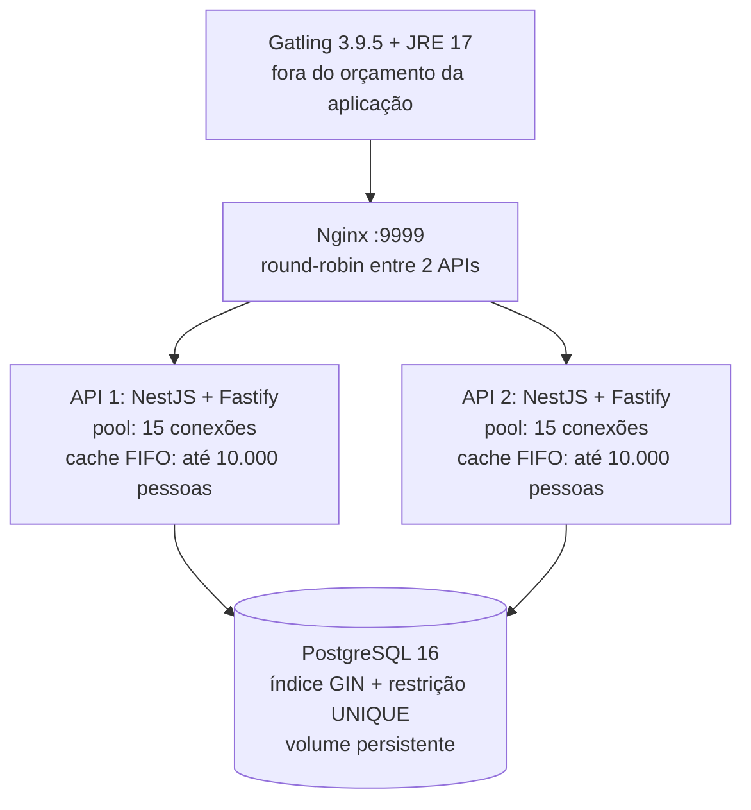

# Rinha de Backend 2023 com NestJS: arquitetura, gargalos e otimizações em números

A configuração final desta implementação persistiu **31.757 pessoas**, contra **8.261** da referência: **23.496 registros adicionais, 3,84 vezes o resultado inicial e ganho de 284,42%**. O orçamento permaneceu em **1,5 CPU e 2.688 MiB de RAM**, somando as duas APIs, o banco e o balanceador.

A maior contagem da campanha foi **34.163 pessoas**, mas com **dois eventos de morte de processo por falta de memória no Nginx**. A configuração final foi escolhida por apresentar **zero eventos OOM observados**, menor proporção de falhas e menor p99 das respostas OK. Ela ainda teve **22,20% de checks KO**: a otimização melhorou o atendimento, mas não fez a aplicação suportar todo o pico sem falhar.

> **Origem dos números:** as quatro cargas deste documento foram executadas **na nuvem, em 16/10/2026**, usando a simulação oficial de 2023 Q3. Os resultados enviados pelo usuário em **19/10/2026**, no **Windows**, confirmam **5 testes unitários e 51 testes/casos HTTP aprovados**. Esses testes funcionais não são uma carga Gatling; ainda não há resultado de carga da máquina Windows para comparar.

## 1. O problema que a API resolve

A [edição 2023 Q3](https://github.com/zanfranceschi/rinha-de-backend-2023-q3) exige uma API de pessoas com criação, leitura, busca e contagem. O desafio de desempenho aparece porque **inserções e buscas concorrem pelo mesmo banco**, enquanto duas instâncias da aplicação dividem um orçamento pequeno de recursos.

| Operação | Comportamento implementado |
| --- | --- |
| `POST /pessoas` | Persiste uma pessoa, devolve `201` e o UUID no cabeçalho `Location`. |
| `GET /pessoas/{id}` | Devolve a pessoa com `200`, ou `404` se o UUID for inválido ou não existir. |
| `GET /pessoas?t=termo` | Procura uma substring em apelido, nome e cada item da stack; ignora maiúsculas e devolve até **50 pessoas**. |
| `GET /contagem-pessoas` | Executa a contagem real no PostgreSQL, sem cache. |
| `GET /health` | Executa `SELECT 1` para verificar a conexão com o banco. |

O contrato foi preservado durante a otimização: apelido único com até **32 caracteres**, nome com até **100**, data de calendário válida em `AAAA-MM-DD` e itens de stack com até **32 caracteres**. A stack aceita ausência, `null` e vetor vazio. Não existe um limite contratual para a quantidade de itens da stack.

Valores obrigatórios ausentes, nulos, vazios, longos demais ou datas impossíveis retornam `422`; tipos incompatíveis e JSON malformado retornam `400`. As strings são preservadas e os limites contam caracteres Unicode. A busca trata `%`, `_` e barra invertida como texto literal.

## 2. Arquitetura e caminho de uma requisição

A aplicação usa **Node.js 24, NestJS 11.2.7, Fastify 5.11.3, PostgreSQL 16 e Nginx 1.28**. O NestJS organiza controladores, serviços e injeção de dependências; o Fastify atende HTTP. O acesso ao banco usa `pg` e SQL parametrizado diretamente, sem ORM.



Em uma criação, o Nginx escolhe uma API, a aplicação valida o JSON, gera um UUID e aguarda o `INSERT` terminar. **Só depois da confirmação do banco** a pessoa entra no cache local e a API responde `201`. Não há confirmação antecipada nem fila de gravação em memória.

O teste oficial lê o endereço retornado em `Location`. Essa leitura pode chegar à outra API: ela procura primeiro no seu cache e, se necessário, consulta o PostgreSQL. As duas réplicas compartilham o banco, portanto não dependem de receber todas as requisições de uma pessoa na mesma instância.

## 3. Limites de CPU e RAM: quanto cada serviço recebe

O teto da edição é **1,5 CPU e 3,0 GB de memória para o conjunto dos serviços**. A configuração final distribui os recursos assim:

| Serviço | Limite de CPU | Limite de RAM | Limite de RAM em bytes |
| --- | ---: | ---: | ---: |
| API 1 | 0,35 | 384 MiB | 402.653.184 |
| API 2 | 0,35 | 384 MiB | 402.653.184 |
| PostgreSQL | 0,65 | 1.664 MiB | 1.744.830.464 |
| Nginx | 0,15 | 256 MiB | 268.435.456 |
| **Total** | **1,50** | **2.688 MiB** | **2.818.572.288** |

**2.688 MiB equivalem a 2,625 GiB ou aproximadamente 2,82 GB decimais.** O total usa **93,95% de 3.000.000.000 bytes**, deixando **181.427.712 bytes** de margem em relação a esse teto. Os valores são limites, não memória necessariamente ocupada o tempo inteiro.

Os limites foram conferidos no runtime, incluindo os arquivos `cpu.max` e `memory.max` dos cgroups v2. Por exemplo, a API usa `cpu.max = 35000 100000`: pode consumir **35 ms de tempo de CPU a cada período de 100 ms**. `0,35 CPU` é uma quota de processamento, não um núcleo físico reservado. A soma das quatro quotas é **1,50**.

Cada processo Node executa com `--max-old-space-size=256`. Isso limita a região old space do heap V8 a aproximadamente **256 MiB** dentro de um contêiner de **384 MiB**. Os **128 MiB** de diferença precisam acomodar outras regiões do heap, memória nativa, buffers, pilhas e demais custos; não representam uma reserva garantida nem um limite total do processo Node.

O gerador Gatling fica fora desse orçamento. O host da nuvem tinha **5 vCPUs visíveis**, quota de **4 CPUs** no cgroup pai e **32 GiB** de memória. O orçamento de 1,5 CPU e aproximadamente 2,82 GB era dos quatro contêineres da solução, não da máquina inteira.

## 4. Como a carga foi medida

Foi utilizado **Gatling 3.9.5 com JRE 17**, com a simulação e os dois arquivos TSV oficiais fixados no commit [`da99faf563c23dca43a5afa2ac31a34ca8cc39e6`](https://github.com/zanfranceschi/rinha-de-backend-2023-q3/tree/da99faf563c23dca43a5afa2ac31a34ca8cc39e6). Esses arquivos foram verificados por hash e não foram alterados para facilitar o teste.

| Cenário | Primeiros 25 segundos | Rampa de 180 segundos |
| --- | --- | --- |
| Criação | 2 usuários/s por 10 s, depois 5 usuários/s por 15 s | De 6 a **600 usuários/s** |
| Busca válida | 2 usuários/s por 25 s | De 6 a **100 usuários/s** |
| Busca inválida | 2 usuários/s por 25 s | De 6 a **40 usuários/s** |

A injeção dura **205 segundos**: 25 segundos iniciais e 180 de rampa. Ao fim da rampa são **740 novos usuários/s**, somando os três cenários. Isso não é uma taxa fixa de requisições HTTP: uma criação com `201` gera também um GET após uma pausa de **1 a 30 ms**. Assim, configurações que criam mais pessoas podem executar mais leituras dependentes.

Cada corrida começou com o banco vazio. As quatro usaram a mesma imagem da API, o mesmo esquema, a mesma carga e rede host; os caminhos de busca/cache foram selecionados por variáveis de ambiente. O fim das respostas pendentes estendeu as janelas observadas para **216,420 a 217,876 segundos**.

Uma execução anterior na rede bridge foi marcada como **inválida por infraestrutura**: a porta publicada recusava conexões enquanto o Nginx respondia pelo IP do contêiner. Ela foi preservada para diagnóstico, mas foi excluída de todos os ganhos apresentados aqui. A configuração portátil do projeto continua usando bridge; o override host foi empregado nas quatro medições válidas da nuvem.

## 5. Referência: por que o desempenho caiu

A primeira configuração válida usou `SEARCH_MODE=scan` e `CACHE_SIZE=0`. A busca comparava o termo em apelido, nome e cada item da stack, sem usar a coluna de apoio como pré-filtro.

O resultado foi **8.261 pessoas persistidas em 75.995 requisições**, com **52.445 checks KO: 69,01% de falhas**. A mediana de todas as requisições ficou em **10.001 ms**, e o p99 das respostas OK em **13.878 ms**.

Uma inspeção do banco encontrou **27 de 29 sessões da aplicação executando buscas**. Outra observação registrou uma busca com **12,79 segundos** de duração. Cada API dispõe de **15 conexões**, totalizando **30**, e espera até **10 segundos** para obter uma conexão do pool. Consultas demoradas ocupavam as conexões e dificultavam a execução de inserções e leituras por ID.

O encadeamento observado foi: buscas caras ocupam CPU e conexões; novas operações aguardam; a fila atinge o timeout do pool; surgem respostas `500`; requisições em andamento também pressionam o balanceador. Os dados sustentam esse diagnóstico de disputa por recursos, mas não medem separadamente o custo de cada etapa.

| Falha registrada na referência | Quantidade |
| --- | ---: |
| Respostas `500` em criação | 30.116 |
| Respostas `500` em consultas/buscas | 9.277 |
| Conexões fechadas prematuramente | 13.034 |
| Conexões recusadas | 18 |
| **Total de checks KO** | **52.445** |

O cgroup do Nginx registrou **2 eventos `oom_kill`** sob o limite de **128 MiB**. O contêiner permaneceu em execução e o Docker mostrou `OOMKilled=false`: esse campo descreve o estado do contêiner e não exclui a morte de um processo interno, como um worker. Por isso foram usados também os contadores do cgroup, em vez de concluir que “contêiner em execução significa ausência de OOM”.

## 6. Otimização da busca: reduzir candidatos antes de conferir os campos

Uma busca como `LIKE '%termo%'` não se beneficia, em geral, de um índice B-tree convencional. A solução mantém uma coluna `busca`, em minúsculas, com apelido, nome e itens da stack separados por um delimitador. Sobre ela foi criado um índice GIN com `pg_trgm`:

```sql
CREATE EXTENSION IF NOT EXISTS pg_trgm;

CREATE INDEX pessoas_busca_trgm
    ON pessoas USING gin (busca gin_trgm_ops);
```

No modo `indexed`, a consulta usa essa coluna para reduzir os candidatos, mas mantém a conferência individual dos campos:

```sql
SELECT id, apelido, nome, nascimento, stack
FROM pessoas
WHERE busca LIKE lower($1)
  AND (
    lower(apelido) LIKE lower($1)
    OR lower(nome) LIKE lower($1)
    OR EXISTS (
      SELECT 1 FROM unnest(stack) AS item
      WHERE lower(item) LIKE lower($1)
    )
  )
LIMIT 50;
```

`$1` recebe o termo escapado e cercado por `%`. A segunda verificação preserva a semântica: uma combinação entre o fim de um campo e o começo de outro não deve gerar um resultado. O limite de **50** também evita devolver um conjunto sem limite de resultados.

O índice tem custo: ocupa espaço e precisa ser atualizado em cada inserção. Termos muito frequentes ou com menos de **3 caracteres** podem aproveitar pouco os trigramas; o PostgreSQL ainda pode escolher uma varredura. Não foi medido um ganho isolado por consulta com `EXPLAIN ANALYZE` nesta campanha.

**Detalhe da comparação:** a coluna e o índice já existiam nas quatro configurações. O modo `scan` desliga o pré-filtro, mas continua pagando a manutenção do índice nas escritas. Portanto o experimento compara caminhos de leitura, não um banco sem índice contra um banco com índice.

## 7. Otimização da leitura por ID: cache positivo e limitado

Cada API mantém um `Map` com até **10.000 pessoas**, usando remoção FIFO: ao atingir o limite, sai a entrada mais antiga. São até **20.000 entradas nos dois processos**, com possível duplicação de pessoas entre eles. Esse limite é de entradas, não de bytes exatos.

O cache recebe somente pessoas que tiveram o INSERT confirmado ou foram encontradas no banco. Não guarda resultados negativos, buscas nem a contagem. Como o contrato não possui UPDATE ou DELETE, uma pessoa persistida não muda durante a execução e a entrada positiva continua válida.

Pessoas com mais de **64 itens na stack** são aceitas, persistidas e consultadas, mas não entram no cache. Isso reduz o risco de um registro válido muito grande ocupar o cache sem inventar um limite novo para a API. Reiniciar uma réplica esvazia apenas o seu cache, preservando os dados no banco.

A segunda corrida ligou **o pré-filtro indexado e o cache juntos**. A contagem passou de **8.261 para 34.163**, diferença de **25.902 pessoas**, ou **+313,55% / 4,14 vezes**. As falhas caíram de **69,01% para 23,18%**, redução de **45,83 pontos percentuais**.

Esse ganho pertence ao conjunto das duas mudanças. Não foi medida taxa de acerto do cache e não há base para afirmar que uma porcentagem específica do ganho veio somente dele ou somente do índice. O Nginx ainda registrou **2 eventos OOM**, portanto a melhor pontuação não eliminou a pressão de memória.

## 8. Escritas e conexões: menos trabalho sem perder consistência

O código faz um único INSERT parametrizado por criação e deixa a restrição `UNIQUE` do PostgreSQL decidir a disputa por apelido. Uma violação `23505` vira `422`. Evitar um `SELECT` prévio remove uma consulta extra do caminho e evita a corrida em que duas réplicas verificam simultaneamente que o apelido ainda não existe.

As consultas usam nomes de prepared statements. Isso permite reaproveitamento por conexão; não significa que exista um único plano global compartilhado pelas duas APIs. A campanha não isolou um ganho percentual para prepared statements, SQL direto ou Fastify: são decisões da implementação, presentes em todas as quatro corridas.

| Ajuste | Valor | Implicação |
| --- | ---: | --- |
| Pool por API | 15 conexões | Até **30** conexões de aplicação nas duas réplicas. |
| `max_connections` do banco | 50 | O pool padrão não ocupa sozinho todo o limite configurado. |
| Espera por conexão | 10.000 ms | A operação falha se não conseguir uma conexão nesse prazo. |
| Timeout de statement | 30.000 ms | Limita a duração de um statement no servidor. |
| Expiração de conexão ociosa | 30.000 ms | Permite liberar conexões sem uso no pool. |
| `shared_buffers` | 384 MB do PostgreSQL | Memória configurada para buffers compartilhados do banco. |
| `work_mem` | 4 MB do PostgreSQL | Orçamento base por operação; hash pode usar `work_mem × hash_mem_multiplier`. Não é um teto global. |
| `effective_cache_size` | 1.024 MB do PostgreSQL | Estimativa para o planejador; não reserva essa memória. |

`fsync`, `synchronous_commit` e `full_page_writes` permaneceram **habilitados**. A resposta `201` espera a confirmação do INSERT, e a contagem executa `SELECT count(*)`. Os resultados não dependem de contar registros que só existem na memória de uma API.

## 9. A tentativa que piorou: dar mais CPU ao banco

Na segunda corrida, as amostras mostraram o banco próximo da quota de CPU, com uso de memória observado chegando a cerca de **168 MiB**, apesar do limite de **1.792 MiB**. O Nginx chegou a cerca de **124 MiB** de um limite de **128 MiB**. Cada API teve mediana de CPU abaixo de **20% de um CPU**.

Isso motivou uma hipótese: transferir parte da CPU das APIs para o banco e parte da memória do banco para o Nginx. A memória observada em amostras não é uma garantia de necessidade máxima futura; da mesma forma, a mediana de CPU não representa os picos.

| Serviço | Execuções 1 e 2 | Execução 3: CPU e memória | Execução 4: padrão final |
| --- | --- | --- | --- |
| Cada API | 0,35 CPU / 384 MiB | 0,25 CPU / 384 MiB | 0,35 CPU / 384 MiB |
| PostgreSQL | 0,65 CPU / 1.792 MiB | 0,85 CPU / 1.664 MiB | 0,65 CPU / 1.664 MiB |
| Nginx | 0,15 CPU / 128 MiB | 0,15 CPU / 256 MiB | 0,15 CPU / 256 MiB |
| **Total em todas** | **1,50 CPU / 2.688 MiB** | **1,50 CPU / 2.688 MiB** | **1,50 CPU / 2.688 MiB** |

Na terceira corrida, a CPU de cada API caiu **28,57%**, de 0,35 para 0,25. O banco ganhou **30,77%** de CPU, de 0,65 para 0,85. O Nginx recebeu **128 MiB adicionais**, dobrando a memória; o banco perdeu **7,14%** do seu limite de RAM.

O resultado regrediu: **31.346 pessoas**, ou **2.817 a menos / −8,25%** em relação à segunda corrida. O p99 OK foi de **12.607 para 18.433 ms**, piora de **5.826 ms / 46,21%**. As falhas subiram para **25,07%**, apesar de a mediana total cair para **152 ms**.

Não houve OOM nos quatro cgroups, mas apareceram timeouts do pool e respostas `502` com `no live upstreams`: sob sobrecarga, o Nginx marcou temporariamente as APIs como indisponíveis. A mediana pequena não compensou a piora da cauda nem a menor quantidade persistida.

A conclusão prática foi restaurar a CPU das APIs. A comparação indica que a redistribuição merece cautela, mas **uma corrida que muda CPU e RAM juntas não prova isoladamente a causa de toda a regressão**.

## 10. A configuração final: manter a RAM e restaurar a CPU

A quarta corrida manteve **256 MiB no Nginx e 1.664 MiB no banco**, mas voltou a **0,35 CPU por API e 0,65 CPU no PostgreSQL**. Assim, conserva a memória da terceira e a CPU das duas primeiras.

O resultado foi **31.757 pessoas**, **411 a mais / +1,31%** em relação à terceira. O p99 OK caiu de **18.433 para 11.115 ms**, redução de **7.318 ms / 39,70%**. As falhas passaram de **25,07% para 22,20%**, queda de **2,87 pontos percentuais**. Os quatro cgroups continuaram com **zero eventos `oom_kill` observados**.

O padrão final ficou **2.406 pessoas / 7,04% abaixo** das 34.163 da segunda corrida. A escolha priorizou menos KO, menor p99 OK e ausência dos eventos de memória observados anteriormente. **Pelo critério da competição, que usa pessoas persistidas, a segunda corrida continua sendo a melhor desta campanha.**

Também houve uma perda em outra métrica: a mediana total final foi **2.939 ms**, contra **1.320 ms** da segunda. A documentação apresenta esse custo, em vez de tratar a configuração final como superior em tudo.

## 11. Os quatro resultados lado a lado

| Métrica | 1. Referência | 2. Índice + cache | 3. CPU + RAM | 4. Só RAM, padrão final |
| --- | ---: | ---: | ---: | ---: |
| Pessoas persistidas | **8.261** | **34.163** | **31.346** | **31.757** |
| Requisições HTTP | 75.995 | 98.368 | 99.758 | 100.175 |
| Checks OK | 23.550 | 75.567 | 74.752 | 77.940 |
| Checks KO | 52.445 | 22.801 | 25.006 | 22.235 |
| Proporção KO | 69,01% | 23,18% | 25,07% | 22,20% |
| Requisições/s, incluindo KO | 350,21 | 451,23 | 459,71 | 459,52 |
| p50, todas as requisições | 10.001 ms | 1.320 ms | 152 ms | 2.939 ms |
| p95, todas as requisições | 12.815 ms | 10.985 ms | 12.632 ms | 10.952 ms |
| p99, todas as requisições | 14.389 ms | 12.853 ms | 16.552 ms | 12.256 ms |
| p99, respostas OK | 13.878 ms | 12.607 ms | 18.433 ms | 11.115 ms |
| Eventos OOM no Nginx | 2 | 2 | 0 | 0 |
| Janela medida | 216,662 s | 217,876 s | 216,420 s | 217,056 s |


### O ganho final em relação à referência

| Indicador | Mudança observada |
| --- | --- |
| Pessoas persistidas | **+23.496**, de 8.261 para 31.757: **+284,42%**. |
| Proporção KO | De 69,01% para 22,20%: **−46,81 pontos percentuais**. |
| p99 das respostas OK | **−2.763 ms / −19,91%**, de 13.878 para 11.115 ms. |
| Fechamentos prematuros | De 13.034 para 323: **−97,52%**. |
| Requisições totais | **+24.180 / +31,82%**, incluindo falhas e leituras dependentes. |
| Eventos OOM no Nginx | De **2 para 0** nas execuções comparadas. |
| Orçamento total | Permaneceu em **1,5 CPU / 2.688 MiB**. |

### Como interpretar os números

**OK não significa pessoa criada.** A simulação considera respostas de validação esperadas, como POST `400` e `422`, checks OK. Na execução final houve **77.940 OK**, mas **31.757 pessoas persistidas**; são medidas diferentes.

**459,52 requisições/s não significam 459,52 inserções/s bem-sucedidas.** A taxa inclui falhas, buscas e leituras por ID. Como um POST aceito dispara um GET, o número total de requisições varia mesmo com o perfil oficial preservado.

**p99 OK não descreve as requisições que falharam.** O p99 OK final de **11.115 ms** resume apenas as respostas cujos checks passaram. O p99 de todas as requisições foi **12.256 ms**, e **22.235 checks falharam**. Os percentis totais incluem falhas que podem terminar sem uma resposta HTTP, como um fechamento de conexão. Não é adequado anunciar atendimento confiável usando somente o menor percentil.

Na configuração final ainda ocorreram **15.302 respostas `500` em criação**, **6.610 respostas `500` em consultas/buscas** e **323 fechamentos prematuros**. A espera por conexão continuou aparecendo nos logs. A pressão de memória foi mitigada nas corridas finais; a saturação e os timeouts não foram eliminados.

## 12. Ajustes de infraestrutura e de execução

O Nginx usa **1 worker**, até **16.384 conexões por worker**, limite de **65.536 descritores**, pool de **128 conexões keep-alive ociosas** para os upstreams e keep-alive de **65 segundos**. Os logs de acesso foram desligados, mantendo logs de erro. Esses ajustes reduzem trabalho potencial de conexão e logging, mas já estavam nas quatro configurações: não há um percentual de ganho isolado medido para eles.

O Dockerfile usa múltiplos estágios: instala dependências com lockfile, compila TypeScript, remove dependências de desenvolvimento e executa JavaScript compilado com o usuário `node`. Não há compilação TypeScript durante a carga. Também não foi medida uma redução isolada de RAM ou latência por causa dessa estrutura de imagem.

Houve correções necessárias para o ambiente funcionar: `pg_isready` por TCP evita prontidão prematura durante a inicialização do banco; os arquivos SQL precisam ser legíveis no contêiner; e casts explícitos no INSERT resolvem a inferência dos parâmetros reutilizados entre colunas `varchar` e expressões de texto. Essas correções aconteceram antes das quatro cargas válidas, não explicam sozinhas o salto entre elas.

A preparação usa JRE **17**, pois o compilador Scala dessa versão do Gatling apresentou incompatibilidade com Java **21**. O uso de rede host contornou a falha de publicação de portas nesta nuvem. São soluções para executar e medir o projeto; nenhuma delas foi apresentada como aceleração isolada do NestJS.

## 13. Como foi verificado que a otimização preservou o comportamento

Antes da campanha, passaram **5 testes unitários e 51 testes/casos HTTP**, além da verificação de tipos e compilação. As verificações incluem criação e leitura entre réplicas, unicidade sob concorrência, validação de datas reais, Unicode, busca literal e limite de resultados.

| Verificação | Número ou resultado |
| --- | --- |
| Testes unitários | **5 aprovados, 0 falhas**. |
| Testes/casos HTTP | **51 aprovados, 0 falhas**. |
| Criações concorrentes com o mesmo apelido | **12 requisições**: 1 criação e 11 respostas `422`. |
| Busca com mais resultados que o limite | **55 pessoas compatíveis**, resposta limitada a **50**. |
| Contagem antes do reinício controlado | **31.757**. |
| Contagem depois do reinício controlado | **31.757**. |
| Pessoa relida após o reinício | Mesmo UUID e mesmo hash SHA-256 do conteúdo. |

Na verificação de persistência, Nginx e APIs foram parados, o PostgreSQL foi reiniciado e os serviços voltaram sem apagar o volume. Isso comprova preservação dos dados nesse reinício controlado; não simula perda abrupta de energia ou falha do armazenamento.

O usuário também executou os testes no Windows: **5 + 51 = 56 aprovados**, sem falhas, cancelamentos ou casos ignorados. Os tempos totais informados foram **869,5962 ms** para a suíte unitária e **1.386,3159 ms** para a suíte HTTP. São durações das suítes, não latências de endpoints nem resultados de carga. Essa validação confirma o funcionamento local, mas não reproduz ainda os números de desempenho da nuvem.

## 14. Comparação com o ranking de 2023

A classificação oficial usa **quantidade de pessoas persistidas**, sem uma fórmula que combine contagem e latência.

| Referência | Pessoas persistidas | Percentual da contagem do vencedor |
| --- | ---: | ---: |
| Vencedor oficial: `viniciusfonseca` | **44.936** | 100,00% |
| Décimo colocado oficial: `navarro-touche` | **36.106** | 80,35% |
| Melhor contagem desta campanha | **34.163** | **76,03%** |
| Padrão final desta implementação | **31.757** | **70,67%** |

A melhor contagem ficou **10.773 pessoas abaixo** do vencedor e **1.943 abaixo** do décimo colocado. O padrão final ficou **13.179 abaixo** do vencedor e **4.349 abaixo** do décimo. Nenhuma dessas execuções recebeu uma colocação oficial.

O vencedor publicou p99 das respostas OK de **17.418 ms**. O menor p99 OK local, **11.115 ms**, não demonstra superioridade: o resultado local teve **22,20% KO**, e as máquinas são diferentes. A coluna “p99 geral” do README oficial corresponde ao p99 **OK** nos artefatos; no vencedor, o p99 de todas as requisições é **17.357 ms**.

O campeonato usou EC2 **t3a.xlarge**, AMD EPYC **7571** e **16 GiB**. Esta campanha usou Intel Xeon Platinum **8573C**, Docker **28.4.0** aninhado, cgroups v2 e armazenamento **vfs**; o Gatling dividiu o host com os serviços, fora do orçamento deles, com heap de até **1 GiB**. O parâmetro Java `ActiveProcessorCount=2` orientou o dimensionamento interno da JVM, sem impor uma quota rígida de 2 CPUs ao gerador. Hardware, armazenamento, rede e disputa por recursos impedem tratar a comparação histórica como uma reprodução idêntica do torneio.

## 15. O que foi resolvido, o que ficou e os próximos experimentos

O projeto entrega o contrato da API com duas réplicas, persistência confirmada antes do `201`, limites verificados e evidência reproduzível da carga oficial. O pré-filtro da busca e o cache aumentaram substancialmente a contagem no experimento conjunto. A transferência de **128 MiB** para o Nginx veio acompanhada da ausência de novos eventos OOM nas duas corridas finais; a redistribuição de CPU que regrediu foi revertida.

Ainda há **22,20% KO**, timeouts de pool e cauda de latência na ordem de **11 segundos** mesmo entre respostas OK. Portanto não se considera a saturação resolvida. A configuração final representa um compromisso observado entre contagem, erros, memória e latência.

Há **uma execução por configuração**, sem estimativa de variabilidade. Os próximos experimentos úteis são separar cache e pré-filtro em combinações independentes, repetir as corridas, medir hit rate e bytes do cache, analisar planos SQL e acompanhar tempo de espera e ocupação do pool. Aumentar o pool além das **30 conexões** padrão sem reduzir o custo das buscas pode apenas ampliar a disputa pela quota de **0,65 CPU** do banco.

O principal aprendizado foi medir o conjunto: a melhor contagem não coincidiu com a ausência de OOM; a menor mediana não coincidiu com a melhor cauda; e entregar mais CPU ao componente aparentemente saturado não garantiu mais registros persistidos.

## Fontes e arquivos para conferir os números

| Evidência | Arquivo |
| --- | --- |
| Referência: 8.261 pessoas | [Resumo da execução 1](../benchmark/evidence/20261016T125218Z-baseline-host/summary.json) |
| Índice/cache: 34.163 pessoas | [Resumo da execução 2](../benchmark/evidence/20261016T125656Z-indexed-cache-host/summary.json) |
| CPU/RAM: 31.346 pessoas | [Resumo da execução 3](../benchmark/evidence/20261016T130257Z-tuned-host/summary.json) |
| Padrão final: 31.757 pessoas | [Resumo da execução 4](../benchmark/evidence/20261016T130832Z-memory-host/summary.json) |
| Testes, persistência e cgroups finais | [Validação registrada](../benchmark/validation.json) |
| Versão e hashes dos insumos oficiais | [Manifesto da simulação](../benchmark/official-source.json) |
| Distribuição final dos serviços | [Docker Compose](../docker-compose.yml) |
| Caminhos SQL, pool e cache | [Serviço de pessoas](../src/pessoas.service.ts) |
| Regras e classificação | [Repositório oficial, versão fixada](https://github.com/zanfranceschi/rinha-de-backend-2023-q3/tree/da99faf563c23dca43a5afa2ac31a34ca8cc39e6) |

Os pacotes em `benchmark/evidence/` incluem relatórios Gatling completos compactados, logs, amostras de recursos, metadados e `SHA256SUMS`. A imagem da API foi a mesma nas quatro medições: `sha256:9fb5aeee3b1eacb61c75f18ba156ca1e0becd7f1f497bb52b7e50e6a9573105d`. Os metadados registram também hashes dos fontes; o HEAD inicial `c08dd33`, registrado antes de commitar a implementação, não identifica sozinho o código medido.

Para explorar tabelas adicionais e os comandos de reprodução, consulte [resultados.md](resultados.md) e o [README](../README.md). Ao baixar este Markdown separadamente, salve-o em `docs/otimizacoes.md` dentro do projeto para preservar os links e a referência ao gráfico.
